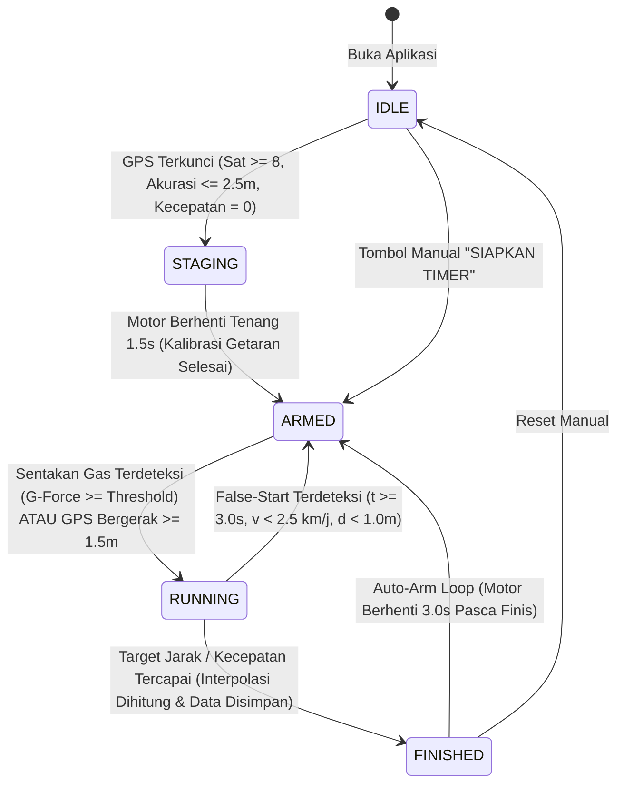

# 🏁 RaceBox Mobile — Drag & Racing Telemetry Engine

<p align="center">
  
</p>

<p align="center">
  <strong>Aplikasi Pengukur Telemetri & Akselerasi Balap Motor/Mobil Berpresisi Tinggi Berbasis Flutter</strong>
  <br>
  <em>100Hz Sensor Fusion • Offline-First GPS Drag Timer • Sub-Millisecond Interpolation</em>
</p>

<p align="center">
  
  
  
  
  
  
  
</p>

---

## 📌 Tentang Aplikasi

**RaceBox Mobile** (Branding: *MIWAR 205 - NYENI MASEHH*) adalah aplikasi telemetri balap mandiri untuk mengukur performa akselerasi kendaraan (motor/mobil) di lintasan trek lurus (*Drag Race*) maupun uji performa jalan raya secara presisi tanpa perlu membeli perangkat keras eksternal mahal seharga jutaan rupiah (seperti Dragy atau RaceBox fisik).

Aplikasi mengombinasikan data akselerometer frekuensi tinggi (100Hz) dengan sinyal satelit GNSS ponsel menggunakan algoritma **Sensor Fusion**, dilengkapi kalkulasi **Linear Interpolation**, **1-Foot Rollout** (standar sirkuit drag race NHRA), serta deteksi kemiringan lintasan (**Track Slope**) untuk menjamin keabsahan rekor.

---

## 🚀 Fitur Unggulan

### 1. ⚡ Sensor Fusion & Zero-Lag Launch Trigger
* **Pemicu Start Seketika (100Hz IMU):** Mendeteksi hentakan putaran gas awal motor secara instan tanpa menunggu jeda delay satelit GPS.
* **Anti-Vibration Noise Floor:** Mengompensasi getaran stasioner mesin motor saat posisi diam (*idle*) agar timer tidak terpicu oleh getaran mesin motor bore-up.
* **Anti-False Start Protection:** Otomatis membatalkan start palsu jika HP hanya kesenggol tangan saat motor masih diam di garis start ($v < 3.0\text{ km/j}$ dan $s < 1.2\text{ m}$).
* **Sensitivitas Pemicu Gas Dinamis:** Pengaturan batas dorong ($0.2\text{G} - 5.0\text{G}$) dengan pilihan cepat (`0.5G`, `1.0G`, `2.0G`, `4.0G`).

### 2. 📏 Presisi Waktu Sub-Milidetik (Linear Interpolation)
* **Kalkulasi Garis Finis Presisi:** Waktu pecahan detik saat ban kendaraan membelah garis target dihitung menggunakan interpolasi linier antar-sampel telemetri, menghasilkan akurasi hingga $0.01\text{ detik}$.
* **Pencatatan Waktu Antara (Split Times):**
  * `60 Feet` (18.28 meter — reaksi peluncuran awal)
  * `100 Meter`
  * `201 Meter` (Standar Drag Bike 1/8 Mile Indonesia)
  * `402 Meter` (Standar Drag Race 1/4 Mile)
  * `0 - 100 km/jam` (Akselerasi kecepatan murni)

### 3. 🏁 Regulasi Balap Sirkuit Resmi
* **1-Foot Rollout (Rollout 1 Kaki = 30.48 cm):** Menghilangkan waktu tempuh 30 cm pertama untuk menyetarakan hasil uji jalan raya dengan sensor laser *photocell* sirkuit resmi dunia.
* **Track Slope Validation:** Mengukur elevasi lintasan dari start ke finis. Sesuai regulasi dunia, kemiringan $\le -1.0\%$ (turunan curam) ditandai sebagai `TIDAK VALID` untuk menjaga sportivitas rekor.

### 4. 📴 Mode Saku (Pocket Mode / Background Service)
* Mendukung pengetesan dengan layar mati saat HP dimasukkan ke dalam saku jaket pembalap.
* Menggunakan Android Foreground Service + isyarat suara audio cue melalui TWS / intercom helm (1x beep panjang = SIAP GAS, 2x beep cepat = FINIS, alert = FALSE START).

### 5. 📊 Visualisasi & Analisis Telemetri Lengkap
* **Kurva Kecepatan & G-Force:** Grafik telemetri 2D interaktif dengan *smoothing filter* dan proteksi batas (*viewport clipping*).
* **Garasi Kendaraan:** Manajemen multi-kendaraan dengan konfigurasi spesifikasi mesin & bobot.
* **Ekspor CSV:** Data telemetri per 100ms dapat diekspor ke file CSV/Excel untuk analisis mekanik dan riset bengkel.
* **100% Offline-First:** Seluruh data riwayat tersimpan aman di database SQLite lokal perangkat.

---

## 🛠️ Tech Stack & Arsitektur

### Core Framework & State Management
* **Framework:** [Flutter](https://flutter.dev/) (Channel Stable, Dart SDK ^3.x)
* **State Management:** [flutter_bloc](https://pub.dev/packages/flutter_bloc) (`Bloc` & `Cubit`) + [equatable](https://pub.dev/packages/equatable)
* **Pola Arsitektur:** **Clean Architecture** (pemisahan layer yang ketat):
  * `core/`: Konstanta, algoritma matematika (Haversine, Interpolator, Fusion Math), dan service audio/foreground.
  * `data/`: DataSource (GNSS, IMU, SQLite Database) dan implementasi Repository.
  * `domain/`: Entities/Models, Abstraksi Repository, dan Business Rules.
  * `presentation/`: BLoC/Cubit, UI Screens, dan Custom Reusable Widgets.

### Hardware & Perangkat Sensor
| Perangkat / Komponen | Package | Fungsi |
| :--- | :--- | :--- |
| **Akselerometer (IMU)** | `sensors_plus: ^7.1.1` | Pembacaan gaya dorong akselerasi 3-sumbu ($a_x, a_y, a_z$) 100Hz |
| **Satelit GNSS (GPS)** | `geolocator: ^14.0.1` | Penentuan koordinat, kecepatan Doppler satelit, dan akurasi radius |
| **Layanan Latar Belakang** | `flutter_foreground_task: ^11.0.3` | Eksekusi mode saku di latar belakang saat layar ponsel terkunci |
| **Layar Tetap Aktif** | `wakelock_plus: ^1.8.1` | Mencegah layar HP mati saat berada di stang motor |
| **Isyarat Audio Cue** | `audioplayers: ^6.8.1` | Sintesis nada beep frekuensi tinggi (Armed, Finish, Alert) |

### Basis Data & Utilitas
* **Penyimpanan Riwayat:** `sqflite: ^2.4.4` (SQLite Engine lokal)
* **Penyimpanan Pengaturan:** `shared_preferences: ^2.5.6` (Preferensi persisten lokal)
* **Grafik Telemetri:** `fl_chart: ^1.2.0` (Visualisasi kurva akselerasi & kecepatan)
* **Ekspor & Berbagi:** `csv: ^8.0.0` & `share_plus: ^13.3.1`
* **Format Waktu & UUID:** `intl: ^0.20.3` & `uuid: ^4.6.0`

---

## 📂 Struktur Direktori Proyek

```
racebox-mobile/
├── assets/
│   └── images/
│       └── app_logo.png             # Logo Racing MIWAR 205 (Frameless Decal)
├── lib/
│   ├── core/
│   │   ├── constants/               # Warna OLED HUD, ambang batas balap
│   │   ├── math/                    # GeoCalculator (Haversine), LinearInterpolator, SensorFusionMath
│   │   └── services/                # AudioCueService, ForegroundServiceManager, WakelockService
│   ├── data/
│   │   ├── datasources/             # SQLite DB, Phone/Simulated GNSS & IMU
│   │   └── repositories/            # Implementasi RaceSession & Vehicle Repository
│   ├── domain/
│   │   ├── models/                  # RaceSession, TelemetryPoint, VehicleProfile, DisciplineType
│   │   └── repositories/            # Kontrak antarmuka Repository
│   ├── presentation/
│   │   ├── bloc/                    # TimerBloc, GarageBloc, HistoryCubit, SettingsCubit
│   │   ├── screens/                 # Splash, Race HUD, History, Detail Telemetri, Garage, Settings
│   │   └── widgets/                 # TelemetryChartWidget, SplitTimesTable, DigitalHudMetric
│   └── main.dart                    # Entry point aplikasi & Inisialisasi Service
├── test/
│   └── unit/                        # 24 Unit Test (FSM, Sensor Fusion, Interpolasi, Persistensi)
└── pubspec.yaml                     # Manifest dependensi Flutter
```

---

## 🚦 Alur State Machine Balap (FSM)



---

## 🧪 Pengujian Unit & Validasi Kualitas

Aplikasi telah divalidasi dengan rangkaian pengujian unit otomatis mencakup:
* **Anti-Vibration Rejection:** Getaran mesin stasioner 0.22G tidak memicu stopwatch.
* **Anti-Jitter Filtering:** Fluktuasi koordinat GPS saat diam (1.2 km/j) tidak memicu start.
* **Sub-Millisecond Interpolation:** Waktu finis 201m diuji matematis tepat 8.00s pada pengujian interpolasi lintasan.
* **Reset Bersih Sesi:** Memastikan seluruh pos *split time* (60ft, 100m, 201m, 402m, 0-100) ter-reset bersih pada setiap tarikan baru.

Jalankan pengujian unit melalui terminal:
```bash
flutter test test/unit/
```

Jalankan audit linter:
```bash
flutter analyze
```

---

## 📲 Cara Instalasi & Kompilasi

### Prasyarat:
* [Flutter SDK](https://docs.flutter.dev/) (versi 3.24 ke atas)
* [Android SDK](https://developer.android.com/studio) (API level 24 ke atas / Android 7.0+)
* Java JBR / JDK 17

### Langkah Menjalankan:
1. **Clone repository:**
   ```bash
   git clone https://github.com/USERNAME/racebox-mobile.git
   cd racebox-mobile
   ```

2. **Unduh dependensi:**
   ```bash
   flutter pub get
   ```

3. **Jalankan aplikasi di perangkat Android fisik:**
   ```bash
   flutter run
   ```

4. **Kompilasi APK Debug / Release:**
   ```bash
   # Debug APK
   flutter build apk --debug

   # Production App Bundle (untuk rilis Google Play Store)
   flutter build appbundle --release
   ```

---

## 📄 Lisensi

Proyek ini dirilis di bawah lisensi [MIT License](LICENSE).

<p align="center">
  Didesain dan dikembangkan dengan penuh passion otomotif 🏁<br>
  <strong>MIWAR 205 (NYENI MASEHH)</strong>
</p>
